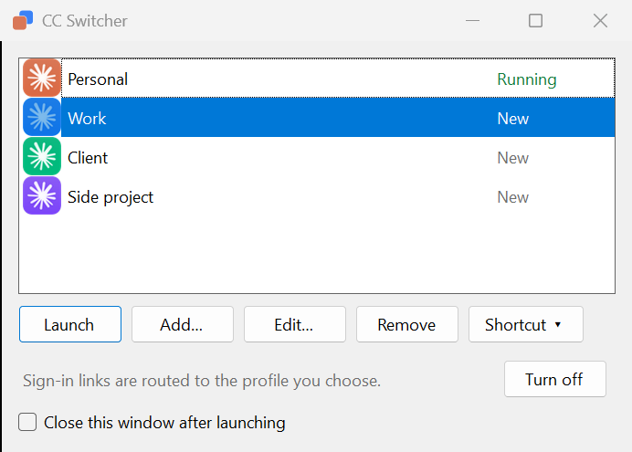
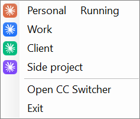

# CC Switcher

Run Claude Desktop under several accounts at once on Windows, such as work and personal, and
tell their windows apart.

Unofficial, and not affiliated with Anthropic.



## Features

- **Several accounts side by side.** Each profile has its own Claude sign-in, and they can all
  be open together.
- **A profile is just a name and a color.** CC Switcher looks after the folders.
- **Windows you can tell apart.** A profile's Claude gets the icon tinted to its color, its own
  taskbar button and a matching window border.
- **Launch from the notification area.** Right-click the CC Switcher icon and pick a profile.
- **Shortcuts.** Put "Claude (Work)" on the desktop or Start menu to open a profile directly.
- **Sign-in links reach the right profile.** Google, SSO and emailed-link sign-in work for every
  profile, not only the first.
- **Separate Claude Code settings, if you want them.** Otherwise every profile shares the
  `.claude` folder in your user folder.

| On the taskbar | In the notification area |
| --- | --- |
|   |  |

## Install

Download `cc-switcher-setup.exe` from the
[latest release](https://github.com/dcramer/cc-switcher/releases/latest) and run it. It installs
for your user only, with no admin prompt. The installer isn't code-signed, so Windows
SmartScreen asks you to confirm with **More info → Run anyway**.

## Getting started

1. Open **CC Switcher** from the Start menu. **Personal** is Claude as it is today; **Work** is
   new.
2. Select **Work**, click **Launch**, and sign in with the other account.
3. Click **Set up…** once so sign-in links reach the profile that asked for them. In the Windows
   Settings page that opens, set the **CLAUDE** link type to CC Switcher.

**Add…** makes more profiles, and **Edit…** renames or recolors one. **Remove** moves a
profile's sign-in data to the Recycle Bin.

## Good to know

- CC Switcher keeps running in the notification area after you close its window, because the
  tinted icons only last while it does. **Exit** in its menu closes it and returns Claude's
  windows to normal.
- A profile left in the first color, Claude's own clay, looks exactly like Claude always has.
- The window border needs Windows 11. Claude's title bar can't be recolored.
- Everything is stored in `%USERPROFILE%\.cc-switcher`. Set `CC_SWITCHER_HOME` to use another
  folder.
- Profiles are separated with a Chromium switch (`--user-data-dir`) that Claude doesn't
  document, so a future Claude version could stop honoring it.

## Command line

```
cc-switcher                     Open the profile list
cc-switcher --profile <name>    Open Claude with that profile
cc-switcher --url <claude://…>  Open a Claude link in a profile
cc-switcher --tray              Start in the notification area
```

## Building

Requires the .NET 9 SDK on Windows.

```
powershell -ExecutionPolicy Bypass -File build.ps1 -Install
```

This builds `dist\cc-switcher.exe` and installs it for your user; without `-Install` it only
builds. Every push to `main` is published as a release by `.github/workflows/build.yml`.

## License

MIT. See [LICENSE](LICENSE).
