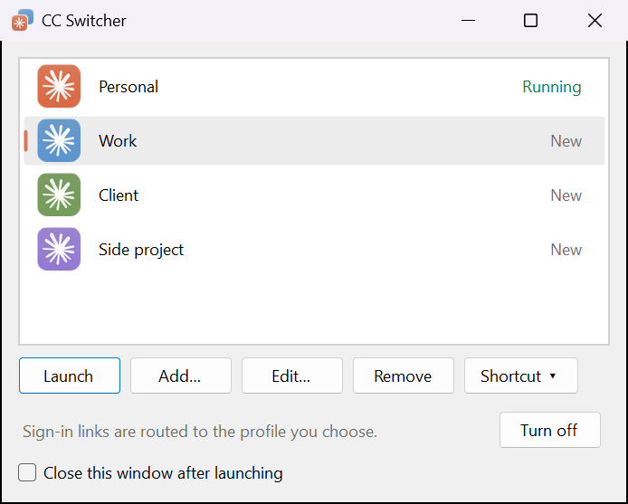

# CC Switcher

Run Claude Desktop under several accounts at once on Windows or macOS, such as work and
personal, and tell their windows apart.

Unofficial, and not affiliated with Anthropic.



## Features

- **Several accounts side by side.** Each profile has its own Claude sign-in, and they can all
  be open together.
- **A profile is just a name and a color.** CC Switcher looks after the folders.
- **Windows you can tell apart.** A profile's Claude gets the icon tinted to its color, its own
  taskbar button and a matching window border.
- **Launch from the notification area.** Right-click the CC Switcher icon and pick a profile.
- **Shortcuts.** Put "Claude (Work)" on the desktop or Start menu to open a profile directly.
- **Sign-in links reach the right profile.** Google, SSO and emailed-link sign-in work for every
  profile, not only the first.
- **Separate Claude Code settings, if you want them.** Otherwise every profile shares the
  `.claude` folder in your user folder.

| On the taskbar | In the notification area |
| --- | --- |
|   |  |

## Install

On a Mac, see [macOS](#macos).

On Windows, download `cc-switcher-setup.exe` from the
[latest release](https://github.com/dcramer/cc-switcher/releases/latest) and run it. It installs
for your user only, with no admin prompt. The installer isn't code-signed, so Windows
SmartScreen asks you to confirm with **More info → Run anyway**.

## Getting started

1. Open **CC Switcher** from the Start menu. **Personal** is Claude as it is today; **Work** is
   new.
2. Select **Work**, click **Launch**, and sign in with the other account.
3. Click **Set up…** once so sign-in links reach the profile that asked for them. In the Windows
   Settings page that opens, set the **CLAUDE** link type to CC Switcher.

**Add…** makes more profiles, and **Edit…** renames or recolors one. **Remove** moves a
profile's sign-in data to the Recycle Bin.

## Good to know

- CC Switcher keeps running in the notification area after you close its window, because the
  tinted icons only last while it does. **Exit** in its menu closes it and returns Claude's
  windows to normal.
- A profile left in the first color, Claude's own clay, looks exactly like Claude always has.
- The window border needs Windows 11. Claude's title bar can't be recolored.
- Everything is stored in `%USERPROFILE%\.cc-switcher`. Set `CC_SWITCHER_HOME` to use another
  folder.
- Profiles are separated with a Chromium switch (`--user-data-dir`) that Claude doesn't
  document, so a future Claude version could stop honoring it.

## macOS

**CC Switcher.app** works like the Windows app: a window listing your profiles, with Launch,
Add…, Edit… and Remove, and a switch that sends sign-in links to the right profile.

Install it by pasting this into Terminal:

```bash
curl -fsSL https://raw.githubusercontent.com/dcramer/cc-switcher/main/mac/install.sh | bash
```

This puts **CC Switcher** in `~/Applications` (find it with Spotlight) and a `cc-switcher` command
in `~/.local/bin`, then opens it. Run the same line again to update. It needs macOS 13 or later
and uses the same `~/.cc-switcher` folder and `settings.json` as the Windows version.

The app isn't signed with an Apple developer account, so if you download `cc-switcher-mac.zip`
from the releases page in a browser instead, macOS won't open it until you allow it in
**System Settings → Privacy & Security**. The install line above avoids that.

1. Open **CC Switcher**. **Personal** is Claude as it is today; **Work** is new.
2. Click **Turn on** so sign-in links reach the profile that asked for them.
3. Select **Work**, click **Launch**, and sign in with the other account. If more than one Claude
   is open when a sign-in link comes back from the browser, CC Switcher asks which profile it's for.

Good to know on macOS:

- Each profile has its own sign-in, chats and Code tab sessions. Claude Code's own folder
  (`~/.claude`: settings, skills, CLI history) is shared unless the profile's
  **Also separate Claude Code settings and history** box is ticked.
- A profile in a color other than Claude's own runs from its own copy of Claude.app, kept in the
  profile's folder, with a custom icon in that color, so its Dock icon and app-switcher icon show
  which profile it is. The copy is an APFS clone, so it takes no extra disk space, and it's
  refreshed from `/Applications` whenever Claude updates.
- Always open profiles through CC Switcher. Claude on macOS doesn't stop two copies from opening
  the same profile, which could damage its data; CC Switcher brings an open profile forward
  instead of starting it again.
- Claude makes itself the `claude://` handler every time it starts, so CC Switcher takes links
  back 15 seconds after it launches a profile.
- The first link CC Switcher hands to Claude may make macOS ask whether CC Switcher may control
  Claude. Allow it, or links can't reach the right profile.
- To build it yourself instead (needs Xcode or the Command Line Tools), run
  `mac/build.sh --install`.

```
cc-switcher                     Open the profile list
cc-switcher --profile <name>    Open Claude with that profile
cc-switcher list                Show profiles and which are running
```

## Command line (Windows)

```
cc-switcher                     Open the profile list
cc-switcher --profile <name>    Open Claude with that profile
cc-switcher --url <claude://…>  Open a Claude link in a profile
cc-switcher --tray              Start in the notification area
```

## Building (Windows)

Requires the .NET 9 SDK on Windows.

```
powershell -ExecutionPolicy Bypass -File build.ps1 -Install
```

This builds into `dist\` the same way releases are built and installs it for your user; without
`-Install` it only builds. Every push to `main` is published as a release by `.github/workflows/build.yml`.
The Mac app is added to a release afterwards from a Mac, with `mac/release.sh`.

## License

MIT. See [LICENSE](LICENSE).
