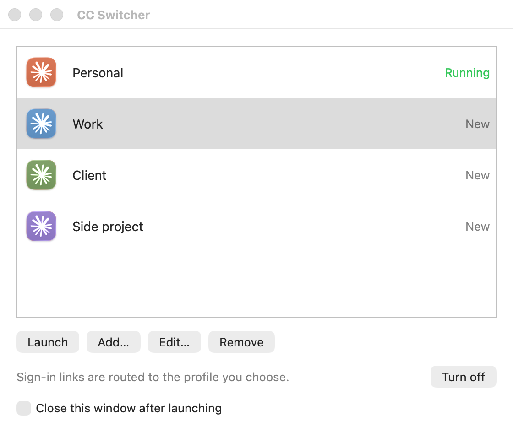
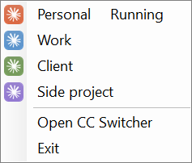

# CC Switcher

Run Claude Desktop under several accounts at once, such as work and personal, and tell their
windows apart. For Windows and macOS.

Unofficial, and not affiliated with Anthropic.

| Windows | macOS |
| --- | --- |
|  |  |

## Features

- **Several accounts side by side.** Each profile has its own Claude sign-in, chats and Code
  sessions, and they can all be open together.
- **A profile is just a name and a color.** CC Switcher looks after the folders.
- **Windows you can tell apart.** A profile's Claude gets its icon tinted to the profile's color:
  on its own taskbar button with a matching window border on Windows, and in the Dock and app
  switcher on macOS.
- **Sign-in links reach the right profile.** Google, SSO and emailed-link sign-in work for every
  profile, not only the first.
- **Separate Claude Code settings, if you want them.** Otherwise every profile shares the
  `.claude` folder in your home folder.
- **On Windows, launch from the notification area or a shortcut.** Right-click the CC Switcher
  icon and pick a profile, or put "Claude (Work)" on the desktop or Start menu.

| On the Windows taskbar | In the notification area |
| --- | --- |
|   |  |

## Install

### Windows

Download `cc-switcher-setup.exe` from the
[latest release](https://github.com/dcramer/cc-switcher/releases/latest) and run it. It installs
for your user only, with no admin prompt. The installer isn't code-signed, so Windows
SmartScreen asks you to confirm with **More info → Run anyway**.

### macOS

Paste this into Terminal:

```bash
curl -fsSL https://raw.githubusercontent.com/dcramer/cc-switcher/main/mac/install.sh | bash
```

This puts **CC Switcher** in `~/Applications` (find it with Spotlight) and a `cc-switcher` command
in `~/.local/bin`, then opens it. Run the same line again to update; your profiles are kept. It
needs macOS 13 or later.

The app isn't signed with an Apple developer account, so if you download `cc-switcher-mac.zip`
from the releases page in a browser instead, macOS won't open it until you allow it in
**System Settings → Privacy & Security**. The install line avoids that.

## Getting started

1. Open **CC Switcher**. **Personal** is Claude as it is today; **Work** is new.
2. Turn on sign-in link routing so links reach the profile that asked for them:
   - **Windows:** click **Set up…**, and in the Windows Settings page that opens, set the
     **CLAUDE** link type to CC Switcher.
   - **macOS:** click **Turn on**.
3. Select **Work**, click **Launch**, and sign in with the other account. If more than one Claude
   is open when a sign-in link comes back from the browser, CC Switcher asks which profile it's
   for.

**Add…** makes more profiles, and **Edit…** renames or recolors one. **Remove** moves a
profile's sign-in data to the Recycle Bin or Trash. Your Claude account itself isn't affected.

## Good to know

- A profile left in the first color, Claude's own clay, looks exactly like Claude always has.
- Profiles are separated with a Chromium switch (`--user-data-dir`) that Claude doesn't
  document, so a future Claude version could stop honoring it.
- Everything is stored in `.cc-switcher` in your home folder, in the same format on both
  systems. Set `CC_SWITCHER_HOME` to use another folder (on macOS this applies to the command
  line only).

### On Windows

- CC Switcher keeps running in the notification area after you close its window, because the
  tinted icons only last while it does. **Exit** in its menu closes it and returns Claude's
  windows to normal.
- The window border needs Windows 11. Claude's title bar can't be recolored.

### On macOS

- Always open profiles through CC Switcher. Claude on macOS doesn't stop two copies from opening
  the same profile, which could damage its data; CC Switcher brings an open profile forward
  instead of starting it again.
- A profile in a color other than Claude's own runs from its own copy of Claude.app, kept in the
  profile's folder, with a custom icon in that color. That's what the Dock shows. The copy is an
  APFS clone, so it takes no extra disk space, and it's refreshed when Claude updates. A new
  color shows the next time the profile starts.
- Claude makes itself the `claude://` handler every time it starts, so CC Switcher takes links
  back 15 seconds after it launches a profile.
- The first link CC Switcher hands to Claude may make macOS ask whether CC Switcher may control
  Claude. Allow it, or links can't reach the right profile.

## Command line

```
cc-switcher                     Open the profile list
cc-switcher --profile <name>    Open Claude with that profile
cc-switcher --url <claude://…>  Open a Claude link in a profile (Windows)
cc-switcher --tray              Start in the notification area (Windows)
cc-switcher list                Show profiles and which are running (macOS)
```

## Building

### Windows

Requires the .NET 9 SDK on Windows.

```
powershell -ExecutionPolicy Bypass -File build.ps1 -Install
```

This builds into `dist\` the same way releases are built and installs it for your user; without
`-Install` it only builds.

### macOS

Requires Xcode or the Command Line Tools.

```bash
mac/build.sh --install
```

This builds a universal, ad-hoc signed `CC Switcher.app` into `mac/dist/` and installs it to
`~/Applications`; without `--install` it only builds.

## Releasing

Every push to `main` is built and published as a release by `.github/workflows/build.yml`, with
the Windows installer. The Mac app is added to the release afterwards, from a Mac:

```bash
git checkout main && git pull
mac/release.sh
```

`mac/release.sh` builds the app and attaches `cc-switcher-mac.zip` to the latest release (or the
tag you pass), and checks that your checkout is clean and at the commit that release was made
from. A release without the Mac app is fine: the Mac installer uses the newest release that has
it.

## License

MIT. See [LICENSE](LICENSE).
